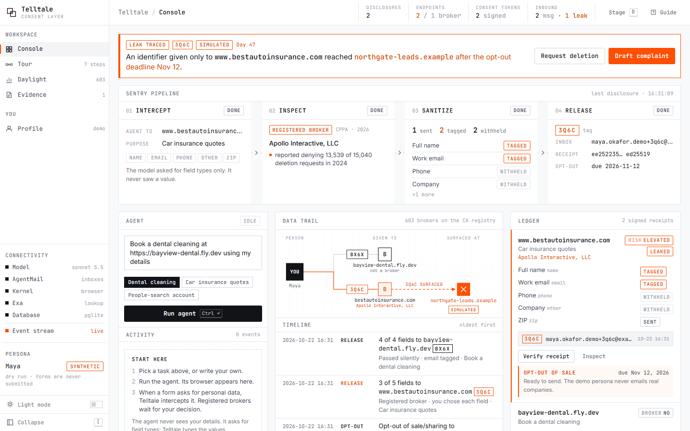
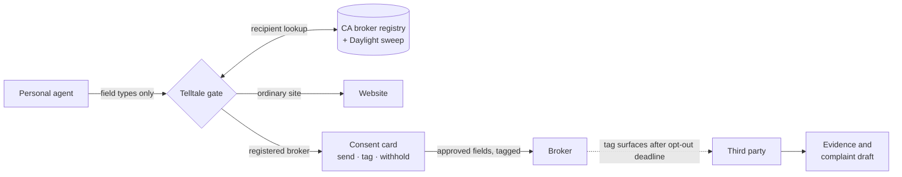
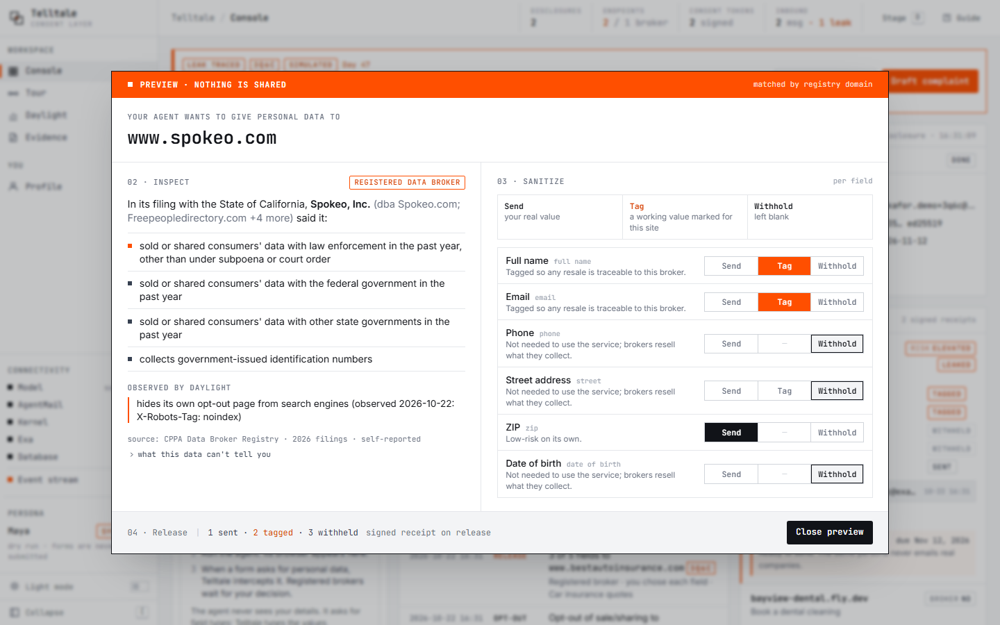
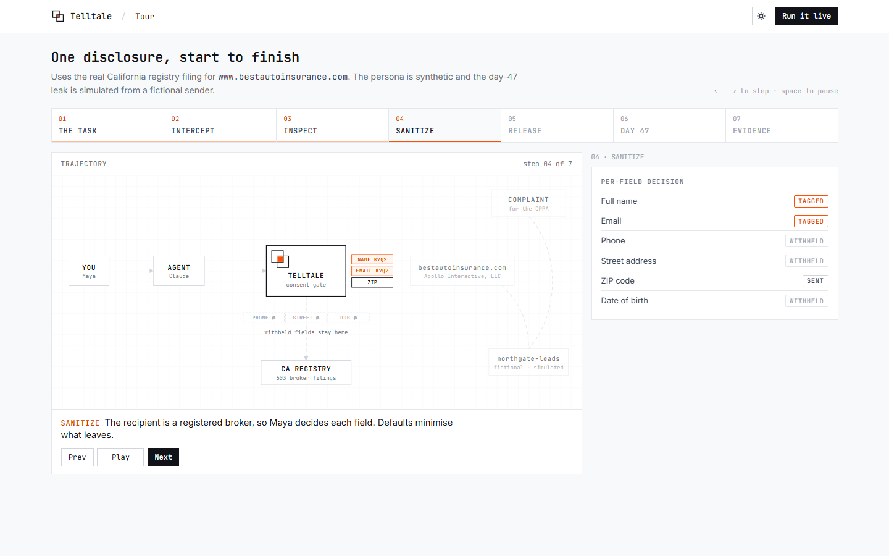
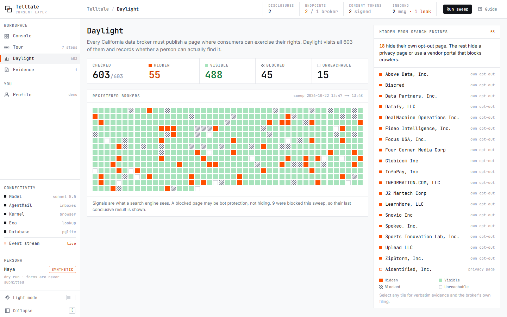
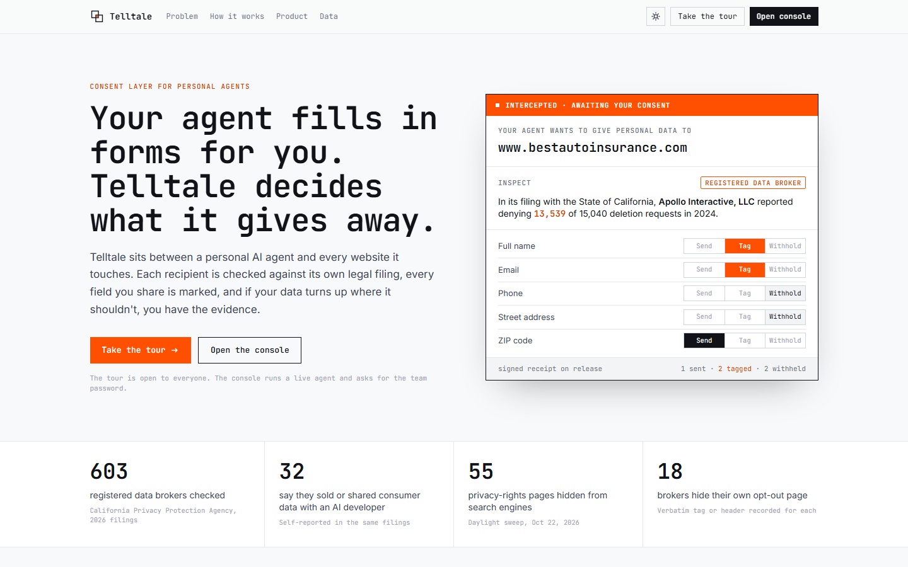
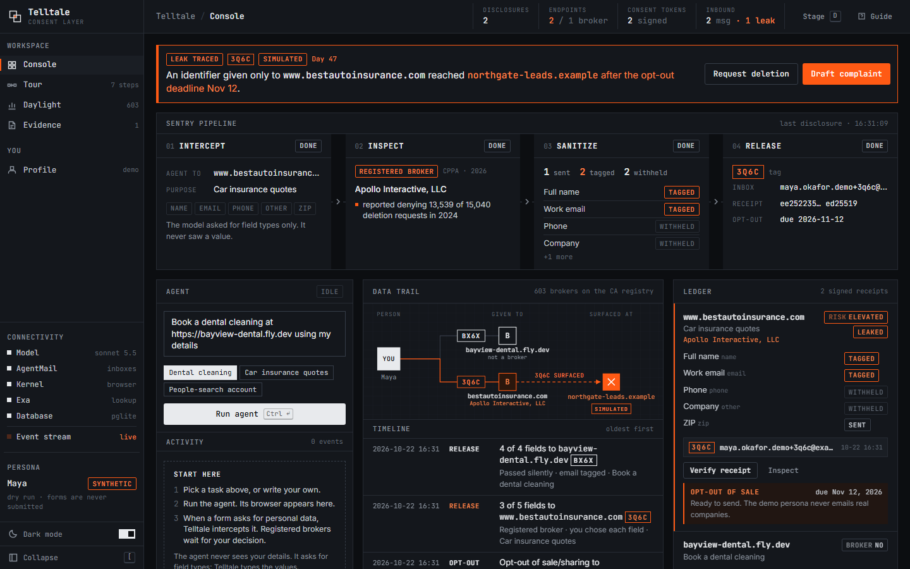

<p align="center">
  
</p>

<h1 align="center">Telltale</h1>

<p align="center">
  A consent layer for personal AI agents.<br>
  Know who gets your data. Mark it. Make them answer for it.
</p>

<p align="center">
  <a href="https://telltale-app.fly.dev">Live demo</a> ·
  <a href="https://telltale-app.fly.dev/tour">Tour</a> ·
  <a href="#how-it-works">How it works</a> ·
  <a href="#run-locally">Run locally</a> ·
  <a href="docs/DEMO.md">Demo script</a>
</p>

<p align="center">
  <a href="https://github.com/elsisiem/telltale/actions/workflows/ci.yml"></a>
  
  
  
</p>

<p align="center">
  
</p>

## Why

Personal agents now fill in forms for people: insurance quotes, sign-ups, appointments. They type a name, an email and an address into whatever form is in front of them, and nobody checks who receives it.

Telltale sits between the agent and every website it touches.

- **Before anything is typed**, it identifies the recipient and checks it against the State of California's data broker registry, where 603 companies answer questions under oath such as whether they sold consumer data to AI developers or shared it with law enforcement without a subpoena.
- **Ordinary sites pass without a prompt.** For a registered broker, the person decides each field: send the real value, send a working value tagged to that site, or leave it out.
- **Every disclosure is marked.** Each site gets its own inbox and a four-character tag, and each decision is recorded in an Ed25519-signed consent receipt.
- **Leaks become evidence.** Telltale sends the broker an opt-out with a 15-business-day legal deadline. If a tagged identifier is later used by someone else, Telltale traces it back and drafts a complaint for the California Privacy Protection Agency. The person reviews it and decides whether to file.

The model never sees personal data. The agent describes form fields by type, and Telltale types the values itself.

## How it works



| Step | What happens |
|---|---|
| **01 Intercept** | The agent reaches a form and calls `fill_form` with field kinds (`email`, `zip`, ...). No values are in the model's context. |
| **02 Inspect** | The recipient's domain is matched to a registry filing, with an Exa company lookup as a fallback. Daylight adds whether the broker hides its own opt-out page. |
| **03 Sanitize** | Ordinary recipients pass silently with a tagged email. Registered brokers stop for a field-by-field decision. SSN, government ID, financial account and date of birth are never altered. |
| **04 Release** | Approved values are typed under a tag, a signed receipt is stored, and the broker can be sent an opt-out of sale and sharing. |

<p align="center">
  
</p>

## What the public data shows

Figures come from the California Privacy Protection Agency's 2026 registry filings and a Daylight sweep run on 2026-10-22.

| Finding | Number |
|---|---|
| Registered data brokers | **603** |
| Say they sold or shared consumer data with a generative-AI developer | **32** |
| Say they shared consumer data with law enforcement without a subpoena or court order | **28** |
| Privacy-rights pages hidden from search engines (`noindex`, `X-Robots-Tag`, robots.txt) | **55** |
| Brokers hiding their own opt-out page | **18** |
| Deletion requests denied by the operator of `bestautoinsurance.com` in 2024 | **13,539 of 15,040** |

The last row is the reason for the demo. A car insurance comparison site looks like a helpful tool. Its operator, Apollo Interactive, LLC, is a registered data broker, and nothing on the page tells you or your agent.

## Features

- **Sentry pipeline.** A live view of each disclosure moving through intercept, inspect, sanitize and release.
- **Consent cards** that quote the recipient's own filing, with the data's limitations one click away.
- **Tagged identities.** One real AgentMail inbox per recipient, an `Attn` address line and a variant middle initial. Mail still arrives. The Identities page shows each site's version of you next to the real one, with its inbox and the mail it received.
- **Signed consent receipts** aligned with ISO/IEC TS 27560, verifiable from the ledger.
- **Opt-out and deletion letters** with deadlines tracked under 11 CCR §7026 and §7021.
- **Leak attribution** from inbound mail, with an evidence page and a complaint draft.
- **Daylight**, a live audit of every registered broker's opt-out page that records the exact tag, header or robots.txt rule.
- **Encrypted profile.** Personal details are stored with AES-256-GCM, with the key held separately.
- **Dry run.** Always on for the synthetic demo persona; a setting for real profiles.
- **Light and dark themes**, a seven-step animated tour and a public overview page.

<table>
  <tr>
    <td width="50%"></td>
    <td width="50%"></td>
  </tr>
  <tr>
    <td width="50%"></td>
    <td width="50%"></td>
  </tr>
</table>

## Privacy and safety

- **The model never sees personal data.** It receives only field kinds and per-field outcomes.
- **Details are encrypted at rest** (AES-256-GCM). The key is a deployment secret or a git-ignored key file, never stored with the data.
- **Fields the law expects to be true are never altered.** The only choice for an SSN or a date of birth is whether to share it.
- **The demo persona is synthetic.** In that mode Telltale never emails a real company and never submits contact details to a real business.
- **Simulations are labelled.** The day-47 leak uses a fictional sender on a reserved `.example` domain, and everything it produces is stamped SIMULATION.
- **People file, not Telltale.** Letters and complaints are drafts. Nothing is sent to a regulator automatically.

## Data sources and limitations

| Source | Used for | Limitations |
|---|---|---|
| [CPPA Data Broker Registry](https://cppa.ca.gov/data_broker_registry/), 2026 filings | Recipient identification, findings, request statistics | Self-reported and not audited by the State. California-registered brokers only, so an unlisted company is not proof of safety. Request counts cover 2024, and a denied request may be one the broker could not verify. |
| Daylight sweep (HTTP, meta robots, `X-Robots-Tag`, robots.txt) | "Hides its opt-out page" findings | Sees what an honest crawler sees. Pages served differently to search engines, or hidden by JavaScript, are not detected. A blocked page may be bot protection. Vendor-hosted portals get softer wording. |
| Exa company search | Matching brand domains that brokers did not list | A name match can be wrong. Used only when the domain itself is not in the registry. |
| Inbound mail on tagged inboxes | Leak attribution | A tag being contacted proves the data moved, not on its own who sold it. The strong case is first contact after the opt-out deadline. |

## Run locally

Requirements: Node.js 20 or later, pnpm 10.

```bash
git clone https://github.com/elsisiem/telltale.git
cd telltale
pnpm install
npx playwright install chromium   # only for the local browser fallback
cp .env.example .env.local        # add ANTHROPIC_API_KEY; everything else is optional
pnpm dev                          # http://localhost:3000
```

```bash
pnpm lint        # ESLint (next/core-web-vitals, next/typescript)
pnpm test        # 45 tests: policy, gate, receipts, vault, identities, leak attribution, Daylight, browser tools
pnpm daylight    # sweep all 603 brokers from the command line (about a minute)
```

The tests need no keys, network access or browser.

## Configuration

Nothing is required to run locally. A deployment needs the rows marked Deployed. Set variables in `.env.local` locally or with `fly secrets set` on Fly.io. `.env.example` lists all of them.

| Variable | Required | Purpose |
|---|---|---|
| `ANTHROPIC_API_KEY` | For the live agent | Runs the agent (Claude Sonnet 5.5, prompt caching, refusal fallback). Without it every screen works and the agent does not run. |
| `ANTHROPIC_WORKSPACE_ID` | No | Workspace ID (`wrkspc_...`), only for keys not scoped to a workspace. |
| `TELLTALE_MODEL` | No | Agent model. Default `claude-sonnet-5-5`. |
| `AGENTMAIL_API_KEY` | No | One real inbox per recipient and inbound attribution. Without it: plus-addressing on the person's email. |
| `KERNEL_API_KEY` | No | Hosted browser with live view. Without it: local Chromium. |
| `EXA_API_KEY` | No | Company lookup for domains missing from the registry. Without it: registry domains and names only. |
| `DATABASE_URL` | No | Neon Postgres. Without it: embedded PGlite. |
| `TELLTALE_DB_DIR` | No | PGlite directory. Default `.telltale/db`; `memory://` keeps nothing on disk (the tests use it). |
| `TELLTALE_PASSWORD` | Deployed | HTTP Basic password for the app (user `telltale`). Without it: no authentication. |
| `TELLTALE_VAULT_KEY` | Deployed | Base64 of 32 random bytes. Encrypts the saved profile. Without it: key file in `.telltale/keys`. |
| `TELLTALE_RECEIPT_KEY` | Deployed | Base64 of an Ed25519 private key in PEM form. Signs consent receipts. Without it: key file in `.telltale/keys`. |
| `TELLTALE_PUBLIC_URL` | Deployed | The deployment's public URL. Pages under `/demo/` on that host count as the app's own fictional demo pages. |
| `TELLTALE_DEMO_HOSTS` | No | Comma-separated fictional demo hosts where submitting is safe. Default `bayview-dental.fly.dev`. |
| `TELLTALE_DRY_RUN` | No | `1` always fills forms without submitting. `0` turns dry run off while no profile is saved. Unset: the synthetic persona is dry run and a saved profile's setting decides. |
| `TELLTALE_HEADLESS` | No | `1` runs the local Chromium without a window. It is always headless on Fly.io. |
| `TELLTALE_BROWSER` | No | `local` forces the local Chromium even when `KERNEL_API_KEY` is set. |

The platform sets `FLY_APP_NAME` and `NEXT_RUNTIME`, and the Dockerfile sets `BUILD_STANDALONE`. You do not set them.

## Deploy

The live site runs on one always-on Fly.io machine in Chicago, next to its Neon Postgres database in AWS us-east-2. Pending consent cards and the event stream live in that process, so it never scales out or sleeps. The fictional dental office used in the demo is a separate static site in [`demo-site/`](demo-site).

One-time setup (requires [flyctl](https://fly.io/docs/flyctl/) and a Fly.io account):

```bash
fly apps create telltale-app
fly secrets set \
  TELLTALE_PASSWORD="<choose a password>" \
  TELLTALE_VAULT_KEY="$(openssl rand -base64 32)" \
  TELLTALE_RECEIPT_KEY="$(openssl genpkey -algorithm ed25519 | base64 | tr -d '\n')" \
  ANTHROPIC_API_KEY="<key>" \
  DATABASE_URL="<Neon connection string>"
fly secrets set AGENTMAIL_API_KEY="<key>" KERNEL_API_KEY="<key>" EXA_API_KEY="<key>"   # optional
fly apps create bayview-dental
```

Keep the vault and receipt keys. Without the vault key the saved profile cannot be decrypted, and without the receipt key earlier receipts no longer verify. No volume is mounted, so without `DATABASE_URL` the embedded database is wiped on each deploy. The app name `telltale-app`, `TELLTALE_PUBLIC_URL` and `TELLTALE_DEMO_HOSTS` are set in `fly.toml`; change them if you pick other app names.

Then deploy:

```bash
fly deploy --remote-only --ha=false              # builds the image on Fly; no local Docker needed
(cd demo-site && fly deploy --remote-only --ha=false)
```

| Path | Page | Access |
|---|---|---|
| `/` | Overview | Public |
| `/tour` | Animated walkthrough of one disclosure | Public |
| `/console` | Agent, pipeline, data trail, ledger | Password |
| `/identities` | Every site's version of you next to your real details, its watched inbox and its mail | Password |
| `/daylight` | Broker opt-out page sweep | Password |
| `/evidence/:id` | Exhibit and complaint draft for a traced leak | Password |
| `/profile` | Encrypted details and dry-run setting | Password |

## Project layout

```
src/
  app/                 routes and API handlers (Next.js App Router)
  components/          console, pipeline, consent card, tour, landing, Daylight board
  lib/
    registry.ts        CPPA registry loader
    resolver.ts        domain to broker matching
    risk.ts            findings quoted from filings
    policy.ts          send / tag / withhold decisions
    gate.ts            the consent gate
    vault.ts           tagged values
    profile-store.ts   encrypted profile and settings
    receipts.ts        Ed25519 consent receipts
    leaks.ts           inbound attribution
    letters.ts         opt-out, deletion and complaint drafts
    agent/             Claude tool loop and browser session
    daylight/          robots parser, page checks, sweep, findings
    integrations/      AgentMail, Exa
data/                  registry CSV and the latest Daylight snapshot
demo-site/             the fictional dental office
tests/                 Vitest suites
```

## Status

- The live site publishes the overview and the tour. The console, Identities, Daylight and evidence pages sit behind a password.
- The demo persona is synthetic and always runs dry: forms are filled and not submitted, and opt-outs are prepared, not sent.
- Coverage is the California registry only. A company missing from it is not proof of safety.
- Letters and complaints are drafts. Nothing is sent to a regulator automatically.
- Pending consent cards and the event stream are held in process memory, so run a single instance.

Not legal advice. Telltale drafts documents; people decide and file.

## Credits

Built for the super{set} National Renaissance Hackathon, Personal Agents and Data Privacy track, with Claude, AgentMail, Kernel, Exa and Neon.

## License

MIT. See [LICENSE](LICENSE).
